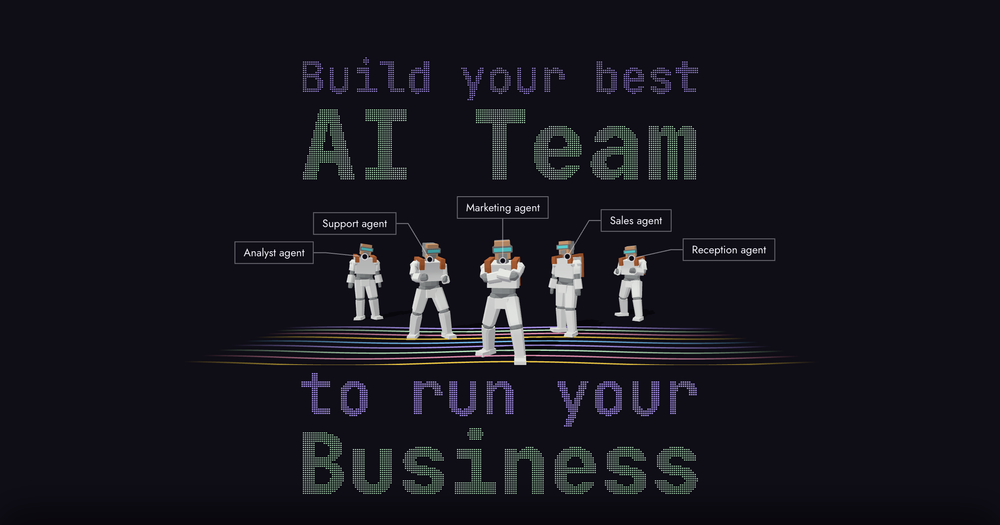
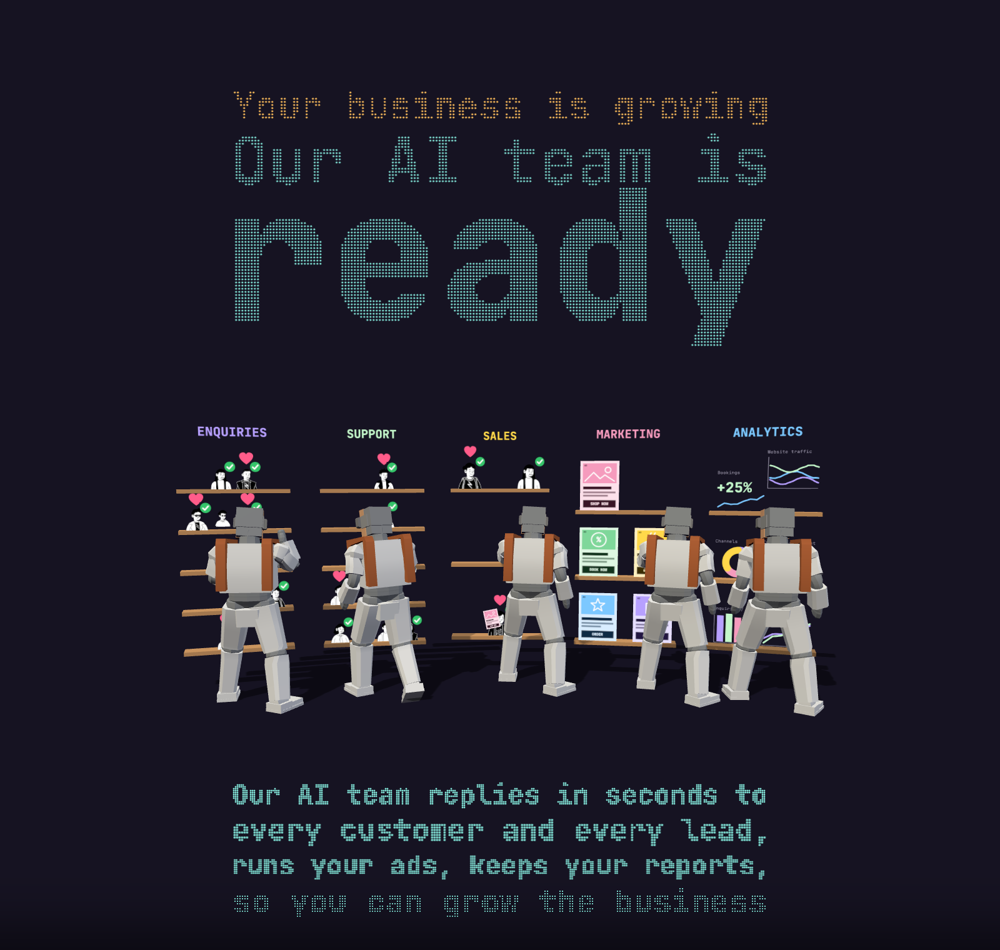

  

<h1 align="center">Wappy AI</h1>

  <b>Run your business with a team of AI agents.</b>
   
  <a href="https://www.wappy.ai/">wappy.ai</a> · <a href="https://www.wappy.ai/">Join the waitlist</a> · <a href="mailto:hello@wappy.ai">hello@wappy.ai</a>

---

## Why

Your business is growing. Is your team ready?

Customers wait hours for a reply, and some give up and buy from whoever answered first. Interested leads go cold because nobody had time to follow up. The same offer goes to everyone, whenever someone finds the time. You guess what's selling and why people walk away. And your day goes on answering the same questions and juggling apps, not on growing the business.

Wappy AI gives you a team of AI agents that takes all of that off your hands. It replies to every customer and every lead in seconds, day and night, follows up until they buy or book, runs your marketing, keeps your reports up to date, and brings in your people when a human is needed.

## The team

Five AI agents, each with its own job, working together on every customer.

| Agent | Helps with | What changes for your business |
| --- | --- | --- |
| **Reception AI agent** | Understands what each customer is really asking and answers instantly, at any hour, from your own website, brochures and price lists. | No customer slips through. Every enquiry gets a reply, and you're the one who answered first. |
| **Support AI agent** | Works out what went wrong, fixes what it can, and raises a ticket for the rest in the helpdesk your team already uses. | No complaint sits unowned in a chat. Problems get solved or handed to the right person, calmly. |
| **Sales AI agent** | Spots buying intent, books the visit or call straight into your calendar, and sends the invite while the customer is still keen. | Interest becomes revenue. Every interested customer is followed up till they buy or book. |
| **Marketing AI agent** | Writes several versions of each offer, sends every customer the one that fits what they've asked and bought, and learns what converts. | Marketing made for each customer, sent at the right moment, without anyone lifting a finger. |
| **Analyst AI agent** | Reads every conversation for intent and frustration, flags customers at risk, and logs what customers ask for that you don't offer yet. | Decide on facts, not hunches. You see what customers want, what converts and where you lose them. |

  

## How it works

1. **It learns your business.** Point Wappy at what you already have: your website, social pages and listings, brochures, price lists, photos. That becomes the team's knowledge bank, kept in sync as things change. No coding.
2. **It goes live where your customers are.** Customers message the way they already do and install nothing. It starts with WhatsApp; WhatsApp is the first channel, not the only one.
3. **It works every conversation.** Each message goes to the right agent. Answers come from your own sources, and actions land in your own tools (a ticket, a booking, a row in a sheet). The team remembers each customer across conversations.
4. **It brings in your people when it matters.** When a conversation needs a human, the team hands it to your staff with the context, instead of guessing.

Hosted for you, nothing to install.

## Connects to your tools

| For | Tools |
| --- | --- |
| Support tickets | Zendesk, HubSpot, Jira, Intercom, Google Sheets |
| Bookings and calls | Google Calendar, Calendly, Zoom, Google Meet |
| Reports and records | Google Sheets |
| Knowledge | Your website, social pages and listings, PDFs, price lists, photos |

## Use cases

- **Real estate:** answer price, possession and home-loan questions from the brochure and price list; book site visits; follow up every enquiry; flag buyers about to walk away.
- **Schools and coaching:** handle admissions enquiries, fees and timings around the clock; book campus visits; send each parent the right programme.
- **Clinics and wellness:** answer questions on services and timings, book appointments, follow up after visits.
- **Shops and D2C brands:** answer product, price and stock questions; follow up interest that went quiet; send offers shaped by what each customer bought.
- **Services and agencies:** qualify leads, book calls, and raise tickets for anything that needs a person.
- **Travel and hospitality:** answer enquiries at any hour, book stays or tours, and send each guest the offer that fits.

## Pricing

| | Free | Paid |
| --- | --- | --- |
| Reception AI agent | Free | Free |
| Every other agent (sales, support, marketing, analyst) | | $30 / month each |
| Conversations | 100 a month included | 100 included, then $0.04 each |
| Website, documents and sheets kept in sync | ✓ | ✓ |
| Calendars, helpdesks and CRMs | | ✓ |
| Hosted for you, nothing to install | ✓ | ✓ |

## Already running on Wappy

30+ businesses already run on Wappy, including NRI Roots, Anu School, Tejo, Comparion and Sanjeevani Properties.

## Get started

Wappy AI is in early access. Join the waitlist at **[wappy.ai](https://www.wappy.ai/)**, or write to **[hello@wappy.ai](mailto:hello@wappy.ai)**.
